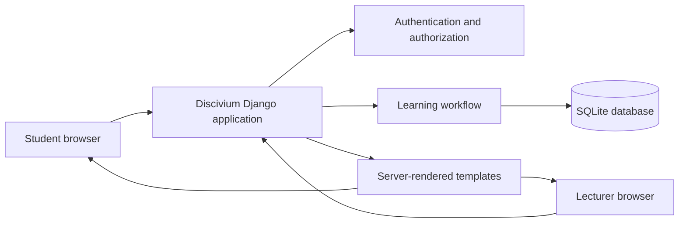
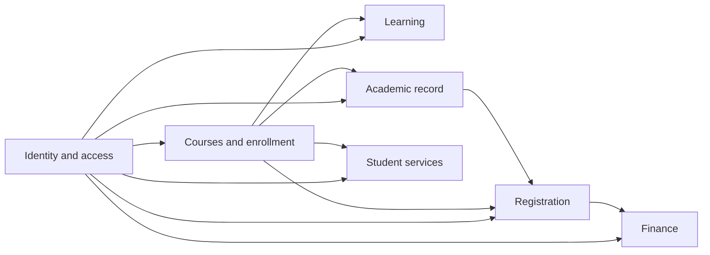
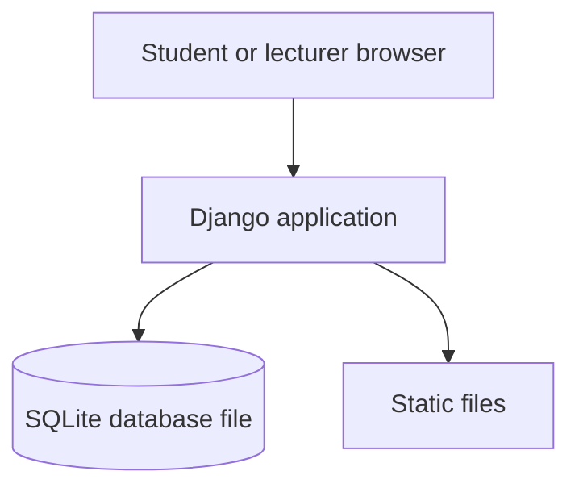

# Proposed technology and system architecture

Status: Proposed

This document describes the proposed architecture for the first Discivium release. It is a design baseline for the learning workflow, not a description of an implemented system. Update it when experiments, requirements or implementation decisions change the design.

## Reader guide and terms

This document uses technical terms so the team can describe the same system precisely. The definitions below are the meanings intended here; they are not claims that the application already exists.

**Editing guidance:** Add a term when a new abbreviation or technical phrase is introduced. Define it once here, then link later uses back to that definition. Keep definitions short and specific to this project.

### Django

The Python web framework proposed for routing, authentication, forms, database access and security features.

### ORM

Object-relational mapper: the [Django](#django) component that lets Python code read and write database records through model objects.

### HTML

HyperText Markup Language, the structure sent to a browser for a web page.

### CSS

Cascading Style Sheets, the rules that control the visual presentation of [HTML](#html).

### PDF

Portable Document Format, a fixed-layout document format.

### DOCX

The modern Microsoft Word document format.

### URL

Uniform Resource Locator, the web address used to identify a page or action.

### HTTP

Hypertext Transfer Protocol, the request-and-response protocol used by the browser and web application. An HTTP 403 response means the server understood the request but refuses access.

### ID

Identifier, the value used to distinguish one stored record from another.

### SQLite

A database engine that stores the prototype database in a local file rather than a separate database server.

### Server-rendered

The [Django](#django) application creates the [HTML](#html) before sending it to the browser.

### Modular monolith

One deployable application split into clear internal modules.

### Microservices

Multiple separately deployed services that communicate over a network.

### Persistence

Saving data so it remains available after a request finishes.

### Traceability

The ability to connect a requirement to its design, implementation, test and demonstration evidence.

### Atomic operation

A group of changes that is saved completely or not at all.

Diagrams use Mermaid, a text-based diagram format supported by some Markdown viewers. If a viewer does not render Mermaid, the diagram source is still the editable record of the design.

## Scope

This section defines what the first release must support and what it deliberately leaves out. It prevents the team from designing or implementing features that are not needed for the initial demonstration.

**Editing guidance:** Change the scope only when the team agrees a requirement has changed. Update the workflow, exclusions, README and roadmap together, and mark optional work as later scope rather than quietly adding it here.

The first release supports this academic workflow:

1. A lecturer publishes an assignment for a course.
2. An enrolled student views the course and upcoming due dates.
3. The student submits an assignment file before or after the due date according to the agreed business rules.
4. The lecturer records feedback.
5. The student views the feedback.

The system also enforces authentication, course membership and role-based permissions. Academic records, registration, finance, notifications, discussion comments and live university integrations are outside this release.

## Architecture drivers

These are the constraints and goals that guide architectural decisions. They explain why the proposed design favors simplicity, security and consistency over additional features or distributed-system complexity.

**Editing guidance:** Add a row only when a constraint changes an architectural choice. State the consequence and cite the requirement, course constraint, experiment or decision that supports it.

The architecture is shaped by these constraints and goals:

| Driver | Why it matters | Architectural consequence | Evidence or source |
| --- | --- | --- | --- |
| Four students are learning the technology while building the system. | The team has limited experience and time for operations. | Prefer familiar tools and one deployable application. | Team capacity and course context. |
| The first release must demonstrate one complete academic workflow. | A complete workflow is more valuable than several disconnected screens. | Prioritize publishing, submission and feedback before optional modules. | First-release scope above. |
| Every team member must run and explain the application locally. | The project must be reproducible and demonstrable. | Keep setup, dependencies and deployment shape small. | Usability and operability requirements. |
| Student and lecturer data must be protected. | Coursework records are associated with real-world roles and permissions. | Enforce authorization on the server for every protected action. | Permission matrix and security requirement. |
| Internal boundaries should remain clear without distributed-system operations. | The team needs maintainability without the cost of networked services. | Use a modular monolith and explicit module ownership. | Architecture comparison below. |
| Requirements, diagrams, tests and runtime must agree. | Inconsistent artifacts make the design difficult to implement and defend. | Maintain traceability and update affected artifacts together. | Consistency rule below. |

## Proposed technology

This section identifies the tools and frameworks the team expects to use. The reasons matter because they show how each choice supports the project goals and can be revisited if evidence contradicts the proposal.

**Editing guidance:** Keep one row per concern. Record proposals as proposals until the team has tested them, then update the evidence and owner/date fields rather than replacing the reasoning with a bare final choice.

| Concern | Proposed technology | Reason for this project | Alternative considered | Evidence still needed | Owner and date |
| --- | --- | --- | --- | --- | --- |
| Language | Python | Familiar, productive and suitable for a small team project. | Another team-supported language | Confirm team familiarity and course compatibility. | Team, YYYY-MM-DD |
| Web framework | [Django](#django) | Provides routing, forms, authentication, [ORM](#orm), migrations and security defaults. | A separate Python web framework | Build one vertical workflow and review the security model. | Team, YYYY-MM-DD |
| Presentation | [Django](#django) templates with [HTML](#html)/[CSS](#css) | Keeps the first release simple and demonstrates the complete [server-rendered](#server-rendered) workflow. | A client-side application | Confirm the workflow is usable without a separate frontend build. | Team, YYYY-MM-DD |
| Database | [SQLite](#sqlite) locally | Low setup cost for the initial prototype; replaceable through [Django](#django)'s database layer. | A separate database server | Run the demonstrated workload and clean setup rehearsal. | Team, YYYY-MM-DD |
| Testing | [Django](#django)'s test framework | Tests views, permissions, models and workflow behavior close to the framework boundary. | A separate test framework | Implement permission and failure-case tests. | Team, YYYY-MM-DD |
| Deployment | One [Django](#django) application process and one database for the prototype | Matches the team's capacity and keeps local setup reproducible. | Multiple services | Confirm another teammate can run the complete workflow. | Team, YYYY-MM-DD |

The final choices must be confirmed after the team tests setup, demonstrates the workflow and reviews quality requirements. Production hosting, a production database and a static-file strategy are not selected yet.

## System shape

This section describes the application's overall structure and how its main parts communicate. The diagram gives readers a high-level view before the document explains individual modules.

**Editing guidance:** Change the prose and Mermaid diagram together. Every box or connection should represent a real boundary in the proposed runtime; do not add a component only because it might be useful later.

Use a [modular monolith](#modular-monolith): one [Django](#django) project with clear internal applications or modules, one deployable runtime and one database. Modules communicate through Python and [Django](#django) interfaces inside the application rather than through network calls.



This shape keeps the boundary between the browser, application and data store visible while avoiding premature distributed-system complexity.

## UML artifacts

The Mermaid diagrams above provide lightweight context inside this document. The editable PlantUML sources in [`docs/diagrams/`](diagrams/) provide the reviewable UML baseline required for the project. They are maintained in the order described in the [UML installation and maintenance guide](diagrams/UML_GUIDE.md).

**Editing guidance:** Update the smallest affected diagram when an architectural decision changes, then check the other diagrams for naming, ownership and relationship consistency. Keep first-release elements solid and future proposals gray or dashed. Do not treat an exported PDF as the source; retain the `.puml` file.

| UML view | Source | Main question it answers |
| --- | --- | --- |
| Component architecture | [`components.puml`](diagrams/components.puml) | Which modules exist and which dependencies are allowed? |
| Deployment | [`deployment.puml`](diagrams/deployment.puml) | Where does the prototype run and store data? |
| Use cases | [`use-cases.puml`](diagrams/use-cases.puml) | Who uses which first-release and future capabilities? |
| Activity | [`submit-assignment-activity.puml`](diagrams/submit-assignment-activity.puml) | What business steps and failure paths occur during submission? |
| System sequence | [`system-sequence-submit-assignment.puml`](diagrams/system-sequence-submit-assignment.puml) | Which public operations does the system expose as one black box? |
| Internal sequence | [`submit-assignment-sequence.puml`](diagrams/submit-assignment-sequence.puml) | Which runtime components communicate for a submission? |
| Domain model | [`domain-model.puml`](diagrams/domain-model.puml) | Which records exist and how are they related? |
| State | [`assignment-submission-state.puml`](diagrams/assignment-submission-state.puml) | Which assignment and submission states are supported? |

## Internal modules

These module definitions assign responsibility for data and business rules. Clear ownership helps the team know where a change belongs and limits accidental coupling between features.

**Editing guidance:** Keep the four ownership fields for every module. If a responsibility moves, update the affected module, domain entities, permission rules and diagrams in the same change.

### Identity and access

- Owns: users, login state, roles and common authorization checks.
- Does not own: course membership, assignments, submissions or feedback records.
- Public operations or data it provides: authenticated user identity and role checks for protected requests.
- Other modules it depends on: none for identity; it receives relationships from Courses and enrollment when a course-specific check is needed.

A request must be authorized from the authenticated user and server-side course relationships; a browser-supplied user [ID](#id) is not an authorization decision.

### Courses and enrollment

- Owns: courses, lecturer responsibility and student enrollment.
- Does not own: login credentials, assignments, submissions or feedback.
- Public operations or data it provides: course membership and teaching-responsibility checks.
- Other modules it depends on: Identity and access for the authenticated user.

It provides the membership information used to determine who may view or change learning records.

### Learning

- Owns: assignments, due dates, submissions and feedback.
- Does not own: user accounts, roles or enrollment records.
- Public operations or data it provides: publish an assignment, submit one assignment file, view permitted submissions and record or view feedback.
- Other modules it depends on: Identity and access for authentication and Courses and enrollment for course relationships.

It coordinates the academic workflow and applies rules such as who may publish an assignment, who may submit, and who may write or view feedback.

### Shared presentation and configuration

- Owns: URL routing, templates, forms, shared validation, settings and static assets.
- Does not own: business records or rules belonging to Identity and access, Courses and enrollment or Learning.
- Public operations or data it provides: browser-facing pages, forms and application configuration.
- Other modules it depends on: all feature modules that supply the data displayed or validated.

It should not contain business rules that belong to identity, enrollment or learning.

## Future product modules

The roadmap names four additional product modules: Academic record, Registration, Finance and Student services. They are future internal Django applications, not first-release features. Defining their boundaries now helps the team understand where later work belongs without requiring the team to build or integrate everything at once.

**Editing guidance:** Add a future module only when the roadmap gives it a clear purpose. For each module, state what it owns, what it must not own, which existing module provides its relationships and how it can be demonstrated with fictional data. Do not add a dependency merely because two screens appear together.

### Roadmap coverage

This table shows how every product module in `ROADMAP.md` is represented architecturally. The first-release status prevents future modules from being mistaken for implemented features; the later scope keeps their intended direction visible without committing the team to build it now.

| Roadmap module | Architecture location | First milestone | Later scope represented by the architecture | Release status |
| --- | --- | --- | --- | --- |
| Learning | `learning/` and the current academic workflow sections | Complete assignment, submission and feedback workflow | Notifications and richer course content | First-release priority |
| Academic record | `academic_records/` and the Academic record boundary below | Fictional result or transcript display | Validated grading policies, transcript exports and official-system integration | Later or optional demonstration |
| Registration | `registration/` and the Registration boundary below | Fictional course selection and simulated enrollment decision | Prerequisites, seat availability, timetable clashes and concurrent enrollment | Later or optional demonstration |
| Finance | `finance/` and the Finance boundary below | Fictional balance, invoice or payment-history display | Authorized payment-provider integration, verified payment events and reconciliation | Later or optional demonstration |
| Student services | `student_services/` and the Student services boundary below | One fictional request and staff decision workflow | Additional request types and notifications | Later scope |

Official records, live university access and real payment processing are not part of this architecture's first release. Any demonstration of academic records or finance must use clearly labeled fictional data and must not imply authorization to access real systems.

### Future module relationship map

The arrows show allowed information or operation dependencies, not direct database ownership. A module may ask another module for an approved operation or read-only result through a defined internal interface; it must not edit another module's records directly.



The relationships mean:

- Identity and access supplies authenticated users and roles to every module.
- Courses and enrollment is the source of truth for courses, teaching responsibility and active enrollment relationships.
- Learning uses course membership but owns assignments, submissions and feedback.
- Academic record uses courses and approved results; it must not treat raw assignment submissions as official results.
- Registration validates course selection and asks Courses and enrollment to create or change an enrollment after its rules pass. It may read Academic record for prerequisite checks.
- Finance references users, courses and enrollment outcomes to represent balances or invoices; it does not own enrollment or academic results.
- Student services uses identity and course context for requests and decisions; it does not edit learning, registration or finance records directly.

### Future module implementation boundaries

| Module | Owns | Does not own | Depends on | First safe implementation shape |
| --- | --- | --- | --- | --- |
| Academic record | Validated course results, GPA calculations and transcript views. | Raw submissions, assignment feedback, enrollment changes or official university data. | Identity and access; Courses and enrollment; an agreed result-input interface. | A fictional result display with explicit fictional-data labeling. |
| Registration | Course selection rules, prerequisite checks, seat or timetable validation and registration requests. | Course definitions, student identity, academic results or payment events. | Identity and access; Courses and enrollment; read-only Academic record data when prerequisites are introduced. | Fictional course offerings and a simulated enrollment decision. |
| Finance | Fictional balances, invoices and payment-history records. | Real payment processing, enrollment ownership or academic results. | Identity and access; Courses and enrollment; approved registration outcomes. | A clearly labeled fictional balance or invoice display. |
| Student services | Student requests, request status and staff decisions. | User accounts, course enrollment, learning records, finance records or official decisions outside the application. | Identity and access; Courses and enrollment; a request-type policy. | One fictional request type with a staff decision workflow. |

Each future module should follow the same internal implementation pattern as Learning: Django models for its own records, views and forms for its browser workflow, permission checks using authenticated relationships, automated tests for success and denial cases, and no direct writes to another module's models. Cross-module behavior should be represented by a small, named interface and tested at that boundary.

A possible [Django](#django) layout is:

```text
project/
  manage.py
  config/                 # settings and root URLs
  accounts/               # authentication and roles
  courses/                # courses and enrollment
  learning/               # assignments, submissions and feedback
  academic_records/       # later: validated results and transcripts
  registration/           # later: course selection and enrollment requests
  finance/                # later: fictional balances and invoices
  student_services/       # later: requests and staff decisions
  templates/
  static/
  tests/
```

The exact package names may change, but the ownership boundaries should remain recognizable in the code and diagrams.

## Proposed permission matrix

This matrix defines which roles may perform each important action. It is the basis for authorization code, permission tests and discussions about privacy; it is not merely a description of which buttons appear in the interface.

**Editing guidance:** Add or change a row only when an action, role or relationship changes. Update its denial behavior and named test reference at the same time; never use a hidden interface control as the permission evidence.

This is the initial permission baseline. The team must confirm it against the final requirements before implementation.

In this matrix, a **response** means one file uploaded by a student as their answer to an assignment, such as a [PDF](#pdf) or [DOCX](#docx) document. It is stored as a `Submission` associated with one authenticated student and one assignment, and includes a reference to the stored file, its original filename and the submission timestamp. It does not include lecturer feedback, course discussion messages or a second file in the same submission.

| Action | Student | Lecturer | Required relationship to the course or record | Denied case and expected result | Test that proves it |
| --- | --- | --- | --- | --- | --- |
| View an enrolled course | Yes | Yes, for courses they teach | Student has an active enrollment; lecturer is responsible for the course. | Unrelated user receives a safe not-found or forbidden response. | `test_course_visibility_by_membership` |
| View published assignments | Yes, in enrolled courses | Yes, in courses they teach | Same course relationship; assignment is published for students. | User cannot see assignments outside the relationship or before publication. | `test_assignment_visibility` |
| Publish or edit an assignment | No | Yes, in courses they teach | Lecturer is responsible for the course. | Student or unrelated lecturer receives a forbidden response; data does not change. | `test_only_course_lecturer_can_publish` |
| Submit a response (assignment file) | Yes, for their own enrolled course | No | Authenticated user has the student role and an active enrollment. | Unauthenticated, unenrolled or lecturer request is rejected; no submission is created. | `test_student_can_submit_when_enrolled` and `test_unenrolled_student_cannot_submit` |
| View a submission | Own submissions only | Submissions for courses they teach | Student owns the submission; lecturer teaches the submission's course. | Unauthorized user receives a safe not-found or forbidden response. | `test_submission_visibility_by_role` |
| Give or edit feedback | No | Yes, for courses they teach | Lecturer teaches the submission's course. | Student or unrelated lecturer cannot create or change feedback. | `test_only_course_lecturer_can_give_feedback` |
| View feedback | Own feedback only | Feedback for courses they teach | Student owns the submission; lecturer teaches its course. | Unauthorized user receives a safe not-found or forbidden response. | `test_feedback_visibility_by_role` |

Every protected action must be checked on the server using the authenticated user and course relationships. Hiding a button or changing a [URL](#url) does not replace an authorization check.

## Main request flow

This section follows data through the application for a typical user action. It shows where authentication, authorization, validation and [persistence](#persistence) must occur so that the implementation does not trust the browser with security decisions.

**Editing guidance:** Keep the numbered flow, the security explanation and the evidence record synchronized. For a new important workflow, copy the evidence structure and fill every field with proposed or verified information.

For a student viewing an assignment:

1. [Django](#django) authenticates the request and identifies the user.
2. The learning view asks the enrollment boundary whether the user belongs to the course.
3. The learning module loads the assignment and relevant submission through the [ORM](#orm).
4. The view selects a template and passes only data the user is allowed to see.
5. The server returns [HTML](#html) to the browser.

For a student submitting a response, the same permission check occurs before file validation and [persistence](#persistence). In [Django](#django), the login process associates the authenticated user with the request session, and the server reads that identity as `request.user`. The server must confirm that `request.user` is authenticated, has the student role and has an active `Enrollment` for the assignment's course. It then creates the `Submission` with `student=request.user`; it must not accept a hidden or visible `user_id` form field as the identity of the submitter. The application should validate the file type and size before saving it, and submission and feedback changes should be saved in an [atomic operation](#atomic-operation) where multiple records must remain consistent.

Use the following template only when documenting a second important workflow. It is needed because a sequence of steps alone does not record the identity, authorization, validation and evidence needed to verify that flow safely.

Request-flow evidence template:

```text
User action:
Authenticated identity source:
Authorization check:
Validation performed:
Records read or changed:
Expected success result:
Expected denied or invalid result:
Test or demonstration reference:
```

Proposed request-flow record for submitting an assignment file:

```text
User action: Student submits one PDF or DOCX file for a published assignment.
Authenticated identity source: Django request session, read as request.user.
Authorization check: request.user is authenticated, has the student role and has an active enrollment in the assignment's course.
Validation performed: Assignment is published; file type is PDF or DOCX; file size is at most 100 MB; submission policy permits the attempt.
Records read or changed: Assignment and Enrollment are read; one Submission is created for request.user.
Expected success result: The file reference, original filename and submission timestamp are persisted and shown to the submitting student.
Expected denied or invalid result: The request is rejected without creating or changing a Submission, and no unrelated record is disclosed.
Test or demonstration reference: Proposed tests test_student_can_submit_when_enrolled and test_unenrolled_student_cannot_submit; implementation evidence pending.
```

## Initial domain model

These definitions identify the core records the system must store and the relationships between them. They provide a shared vocabulary for the database, class diagram, code and tests.

**Editing guidance:** Add an entity only when the workflow or a requirement needs information that an existing entity cannot own clearly. Update relationships, module ownership, class diagrams and test data whenever a row changes.

The minimum domain entities are:

| Entity | Purpose | Required fields | Relationships and ownership | Rules it must enforce | Example test data |
| --- | --- | --- | --- | --- | --- |
| `User` | Authenticated person with a role. | Identifier, login identity, role. | Owned by Identity and access; may be a student or lecturer. | Login identity is established by the server, not a submitted user ID. | Fictional student and lecturer accounts. |
| `Course` | A course offering or teaching context. | Identifier, name, responsible lecturer. | Owned by Courses and enrollment; has assignments and enrollments. | A lecturer must be associated before publishing an assignment. | Fictional course `COMP101`. |
| `Enrollment` | Relationship between a student and a course. | Student, course, active status. | Owned by Courses and enrollment; links one student to one course. | Only an active enrollment grants student access to course learning records. | Fictional student enrolled in `COMP101`. |
| `Assignment` | A task published in a course with a due date. | Course, title, due date, publication state. | Owned by Learning; belongs to one course and has submissions. | Only the responsible lecturer may publish or edit it. | Published assignment with a future due date. |
| `Submission` | One student's uploaded assignment file. | Student, assignment, stored-file reference, original filename, timestamp. | Owned by Learning; belongs to one student and one assignment. | One file per first-release submission; student must be enrolled. | Fictional student uploads a valid PDF fixture. |
| `Feedback` | Lecturer feedback associated with a submission. | Submission, lecturer, feedback text, timestamp. | Owned by Learning; belongs to one submission and its course lecturer. | Only the responsible lecturer may create or edit it; only authorized users may view it. | Lecturer feedback on the fictional PDF submission. |

Important relationships:

- A course has many assignments.
- A course has many enrollments.
- An assignment has many submissions.
- A student may submit only when enrolled in the assignment's course.
- A submission has at most the feedback allowed by the agreed workflow.
- A submission contains one uploaded file in the first release. The proposed accepted types are [PDF](#pdf) and [DOCX](#docx), with a maximum size of 100 MB per file; the team must confirm these values before implementation.

The team must decide and document whether resubmission is supported, whether late submissions are accepted, whether feedback can be edited, and whether an assignment can be unpublished after submissions exist.

## Proposed workflow rules

These rules turn the product idea into observable behavior. They define what the system must allow or reject, especially in cases where a user bypasses the normal interface or data is incomplete.

**Editing guidance:** Write rules as observable behavior with a valid condition, invalid condition, response, protected data and evidence reference. Keep unresolved policy decisions explicitly marked as decisions required.

These rules make the first implementation testable while leaving policy choices visible:

| Rule | Valid condition | Invalid condition | System response | Data that must not change | Test or demonstration reference |
| --- | --- | --- | --- | --- | --- |
| Only the responsible lecturer may publish an assignment. | Authenticated lecturer teaches the course. | Student or unrelated lecturer attempts publication. | Allow the change for the responsible lecturer; return a forbidden response otherwise. | Assignment publication state for a denied request. | `test_only_course_lecturer_can_publish` |
| Only an enrolled student may submit. | Authenticated student has an active enrollment. | User is unauthenticated, not enrolled or a lecturer. | Validate and create the submission only for the enrolled student. | No `Submission` for a denied or invalid request. | `test_student_can_submit_when_enrolled`; `test_unenrolled_student_cannot_submit` |
| The submission owner comes from the authenticated session. | `request.user` is an authenticated student. | Form contains a different or unauthorized user ID. | Ignore any submitted user ID and use `request.user`. | No submission owned by another user. | `test_submission_uses_authenticated_user` |
| Students see only published assignments. | Assignment is published and belongs to an enrolled course. | Assignment is unpublished or belongs to another course. | Show the assignment only to an authorized student. | Assignment publication state and unrelated records. | `test_unpublished_assignment_is_hidden` |
| Students see only their own submission and feedback. | Authenticated student owns the submission. | Another student requests the record. | Return a safe not-found or forbidden response. | The other student's record. | `test_submission_visibility_by_role`; `test_feedback_visibility_by_role` |
| Lecturers manage learning records only for their courses. | Lecturer teaches the submission's course. | Unrelated lecturer attempts to view or change it. | Allow authorized access and reject unrelated access. | Submission and feedback for a denied request. | `test_only_course_lecturer_can_give_feedback` |
| Invalid or unauthorized requests do not disclose records. | Request is authorized and valid. | Request lacks authorization or contains invalid data. | Return a safe error response without revealing record existence. | All unrelated records. | Proposed direct-URL and invalid-form tests; implementation evidence pending. |
| Late submissions, resubmissions, unpublishing and feedback editing | Policy is confirmed by the team. | Policy is not yet confirmed. | Keep these behaviors disabled or explicitly unresolved. | Existing submission and feedback records. | Decision required before implementation. |

## Quality requirements to validate

These requirements describe how well the system must work, not only what features it has. Each requirement should eventually become a measurable scenario, test or demonstration check.

**Editing guidance:** Use one scenario per quality attribute. Replace vague claims with a Given/When/Then situation, a pass threshold and a concrete evidence location; do not mark a requirement passed before evidence exists.

| Quality attribute | Given | When | Then | Measure or pass threshold | Evidence location |
| --- | --- | --- | --- | --- | --- |
| Security | A student is enrolled in one course. | The student requests a submission from another course. | The system returns a safe not-found or forbidden response and reveals no record. | All permission-matrix denial tests pass. | Permission tests and demonstration record. |
| Correctness | A responsible lecturer, published assignment and enrolled student exist. | The student submits a valid file and the lecturer gives feedback. | The expected assignment, submission and feedback state is persisted. | Each workflow state is verified by an automated test. | Workflow tests and traceability table. |
| Usability | A teammate has a clean clone and the documented prerequisites. | They follow the setup instructions and complete the workflow. | They run the application without undocumented steps. | One clean setup rehearsal succeeds on another teammate's machine. | Deployment evidence record. |
| Maintainability | A feature request affects one business capability. | A teammate implements the change. | The change stays within its owning module unless a documented boundary requires coordination. | Review identifies no unexplained cross-module changes. | Pull request review and module definitions. |
| Testability | A permission or workflow rule is defined. | The implementation is reviewed. | A named automated test covers success and relevant failure behavior. | Every permission row has at least one test reference. | Permission matrix and test suite report. |
| Operability | Fictional seed data and setup instructions are available. | A teammate recreates the local environment. | No real student information, credentials or uploaded files are required. | Clean setup uses only repository instructions and fictional data. | Deployment evidence and repository review. |

The team should replace qualitative wording with measured acceptance criteria where the course requirements demand it.

## Testing and traceability

This section states what evidence will demonstrate that the architecture is implemented correctly. [Traceability](#traceability) connects requirements to code ownership, diagrams and tests instead of leaving them as separate documents.

**Editing guidance:** Add a traceability row when a requirement becomes final or changes. Reference a real test, diagram or demonstration result, and label planned evidence as proposed or pending rather than presenting it as completed.

The implementation should provide evidence for each important boundary:

| Area | Minimum evidence |
| --- | --- |
| Authentication | A user must be signed in before accessing protected workflow pages |
| Permissions | Tests cover each role/action pair in the permission matrix, including direct unauthorized requests |
| Workflow | Tests cover publishing, viewing, submitting and giving feedback for valid data |
| Failure cases | Tests cover missing records, unenrolled students, wrong lecturers and invalid form data |
| Persistence | Tests confirm the expected assignment, submission and feedback state after each operation |

Maintain a small [traceability](#traceability) table as requirements become final. Each requirement should point to its owning module, relevant diagram and at least one test or demonstration step. This prevents the architecture document from becoming separate from the implementation.

Example evidence and traceability entry:

This example is included because future requirements will need a consistent way to prove both successful behavior and protected failure behavior before the application exists.

```text
Requirement: An enrolled student can submit one assignment file.
Owning module: learning, using enrollment authorization.
Design reference: Proposed permission matrix and student-submission sequence diagram.
Test evidence: `test_student_can_submit_when_enrolled` passes with a PDF fixture.
Failure evidence: `test_unenrolled_student_cannot_submit` receives HTTP 403 and creates no Submission.
Demonstration evidence: A student account submits a file; the lecturer sees it; another student's account cannot open it.
Result: Pass / Fail / Needs decision.
Reviewer and date:
```

Use the following table when new requirements are added. It is needed because traceability grows over time, while the architecture document's current requirements table is only the initial baseline.

Traceability table template:

| Requirement | Owning module | Design reference | Test or demonstration evidence | Reviewer and date | Status |
| --- | --- | --- | --- | --- | --- |
| Example: enrolled student can submit one file | `learning` | Permission matrix, sequence diagram | Test names and demonstration result | Name, YYYY-MM-DD | Proposed |

## Deployment view

This section describes where the system runs and where its data is stored. The initial view keeps setup small while making deployment assumptions visible for later review.

**Editing guidance:** Record only environments the team has agreed to support. After each clean setup rehearsal, update the command, storage, configuration and result fields; keep local databases, uploads and credentials out of the repository.

For the initial local prototype, the deployment target is deliberately small:



Local database files, uploaded files, environment files and credentials remain outside version control. Migrations, fictional seed data and setup instructions belong in the repository once implementation begins. Uploaded files should use the application's local media storage during development; the final deployment storage location remains undecided.

A later deployment may separate the application server, database and static-file hosting. That is an evolution option, not part of the first release commitment.

Use the following template for each clean setup rehearsal or deployment environment. It is needed because setup failures often come from undocumented commands, storage locations or environment values that are not visible in the architecture diagram.

Deployment evidence template:

```text
Environment:
Application start command:
Database location:
Uploaded-file storage location:
Required environment variables:
Migration or seed-data steps:
Clean setup result:
Reviewer and date:
```

Proposed local deployment record:

```text
Environment: Each teammate's local development machine.
Application start command: To be added and verified when the first runnable application is merged.
Database location: Local SQLite database file outside version control.
Uploaded-file storage location: Local media storage outside version control.
Required environment variables: To be listed in .env.example when configuration is introduced.
Migration or seed-data steps: To be documented with the first application setup instructions.
Clean setup result: Pending implementation and rehearsal on another teammate's machine.
Reviewer and date: Team, YYYY-MM-DD.
```

## Alternative considered: microservices

This comparison records why the team is not selecting a more distributed design for the first release. Considering an alternative makes the architecture decision defensible rather than accidental.

**Editing guidance:** Add an alternative only when it could realistically satisfy a project quality requirement. Compare benefits, new complexity and evidence, then record the decision without presenting the alternative as an implemented capability.

[Microservices](#microservices) could isolate identity, courses and learning into separately deployed services. That would add independent deployment, service contracts, network failure handling, observability and data ownership decisions.

For this four-person project and first-release scope, the [modular monolith](#modular-monolith) is the current proposal because it reduces operational work while preserving internal boundaries that can be tested and evolved. The team should revisit the choice only if a concrete quality requirement or experiment shows that one deployable application cannot meet the need.

Proposed alternative comparison:

```text
Alternative: Microservices for identity, courses and learning.
Quality requirement it may improve: Independent deployment or independent scaling if the system grows substantially.
New complexity or risk: Network failures, service contracts, separate data ownership, deployment and observability work.
Evidence considered: Four-person team, first-release learning workflow and local demonstration requirements.
Decision: Do not select for the first release; use a modular monolith with clear internal boundaries.
```

## Decisions still to record

These are unresolved choices or pieces of evidence needed before the proposal can become the final architecture. Keeping them visible prevents assumptions from being mistaken for completed decisions.

**Editing guidance:** Add a checkbox for each unresolved choice or evidence item. Check it only after the team has agreed the decision and recorded its reasoning in the shared decision format.

- [ ] Confirm the first-release functional requirements and permission matrix.
- [ ] Decide the submission, late-work and resubmission rules.
- [ ] Decide the supported user roles and account creation approach.
- [ ] Confirm whether SQLite remains sufficient for the demonstrated workload.
- [ ] Build and retain use case, activity, sequence, state, class, component and deployment diagrams.
- [ ] Run a clean setup rehearsal on another team member's machine.
- [ ] Record the final architecture choice in `docs/decisions/` with evidence.

For new architecture decisions, use the shared [architecture decision template](decisions/0000-template.md) rather than creating another form in this document. The completed record below is included only to show how the current proposal would be recorded.

Proposed architecture decision record:

```text
Decision title: First-release application architecture.
Status: Proposed.
Date: 2026-10-28.
Owners: Team members to confirm; record names only with agreement and never include student IDs.
Context: The first release needs one complete learning workflow that four students can build, run and explain.
Alternatives: Modular monolith; microservices.
Decision and reason: Use one Django modular monolith and one local SQLite database because it minimizes operational work while preserving internal module boundaries.
Consequences: Simpler setup and testing; less independent deployment; future separation remains possible if evidence justifies it.
Evidence and links: Architecture drivers, technology table, permission matrix, deployment view and clean setup rehearsal.
Review date: After the first vertical workflow and setup rehearsal.
```

## Consistency rule

This rule explains how to keep the project artifacts aligned as the design changes. A diagram, requirement, test or implementation should not silently describe a different system from the others.

**Editing guidance:** Before merging an architecture change, check the affected scope, modules, permissions, domain model, workflow rules, tests, diagrams and README. Update each affected artifact or explain why it remains unchanged.

The repository structure, diagrams, requirements, tests and demonstrated runtime must describe the same system. When one changes, update the affected artifacts together and note the decision that caused the change.
